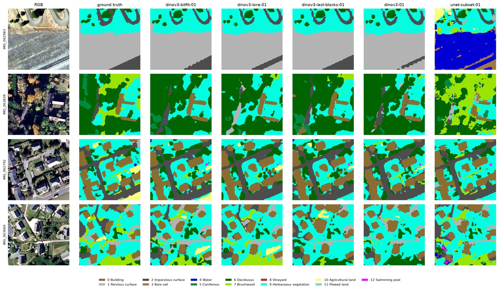

# Land-cover segmentation with a DINOv3 backbone

Fine-tune a DINOv3 vision backbone for 13-class land-cover segmentation on
IGN's FLAIR#1 aerial imagery, and measure how much it improves over a classic
U-Net/ResNet34 baseline.

> **Result:** a frozen DINOv3 ViT-L/16 with a 1.6 M-parameter BitFit+ adaptation
> reaches **0.590 test mIoU**, **+21.2 points** over a fully trained
> U-Net/ResNet34 (0.378), on a whole-domain subset of FLAIR#1.

*Four held-out test tiles sampled across the two test domains. Columns: RGB,
ground truth, and the predictions of each run's best-validation checkpoint
(BitFit+, LoRA, last 4 blocks, linear probe, U-Net).*

## The problem

Land-cover mapping asks for a class label at every pixel of an aerial image.
This project uses the 13-class nomenclature of IGN's FLAIR#1 benchmark and
works on 512×512 tiles with five channels: red, green, blue, near-infrared and
a normalised digital surface model (nDSM) that carries building and vegetation
height.

Two things make the task interesting. First, the test split is made of spatial
domains held out from training, so a model has to generalise to new regions
rather than memorise the training sites. Second, the classes are heavily
imbalanced: water and buildings cover large, homogeneous areas, while bare
soil, brushwood, vineyards and swimming pools are rare and easily missed.

The question behind the experiments is simple: **how much does a large
self-supervised backbone buy over a task-specific CNN, and how little
fine-tuning is enough to get that gain?**

## The dataset

[FLAIR#1](https://github.com/IGNF/FLAIR-1) is an IGN dataset of 512×512 aerial
patches with five channels and land-cover labels derived from the OCS GE
nomenclature:

`Building, pervious surface, impervious surface, bare soil, water, coniferous,
deciduous, brushwood, vineyard, herbaceous vegetation, agricultural land,
plowed land, swimming pool.`

The full dataset holds 77,409 tiles over 50 spatio-temporal domains (32 train,
8 validation, 10 test). The reported runs use a whole-domain subset that fits a
25 GiB staging budget: the first 3 train domains, first 2 validation and first
2 test domains, i.e. **5,275 / 3,550 / 2,250 tiles** (13.6 GiB). Keeping whole
domains means no tile is shared between splits, so the comparison still tests
generalisation to unseen regions.

## Models and fine-tuning

**Baseline — U-Net/ResNet34.** A `segmentation-models-pytorch` U-Net with an
ImageNet-pretrained ResNet-34 encoder, adapted to five input channels. It has
24.4 M parameters, all trained, and is the classic supervised reference.

**DINOv3 ViT-L/16.** The backbone is timm's
`vit_large_patch16_dinov3.sat493m`, a ViT-L/16 distilled on 493 M satellite
images. At 512×512 it produces a 32×32 map of 1,024 patch tokens. The head is
a 1×1 convolution on the last block's patch map, upsampled 16× (the DINOv3
linear-probe recipe). In the frozen-probe arm the backbone stays frozen; the
head and the patch-embedding convolution train, the latter so the
zero-initialised NIR and nDSM filters can learn. The backbone has 303.6 M
parameters in total.

Four arms cover the spectrum from a frozen probe to partial fine-tuning:

| Arm | What trains beyond the head and stem | Trainable |
|---|---|---:|
| Linear probe | nothing — the backbone is frozen | 1.33 M |
| BitFit+ | every bias, every LayerNorm affine pair, every LayerScale vector | 1.62 M |
| Last 4 blocks | blocks 20–23 whole (attention, MLP, norms, scales) + final LayerNorm | 51.71 M |
| LoRA r=16 | low-rank adapters beside `attn.qkv` and `attn.proj` in all 24 blocks | 3.68 M |

The recipes share everything else on purpose: cross-entropy + Dice loss
(50/50), AdamW, one warmup epoch then cosine decay, 16-bit mixed precision,
batch 8 at 512×512, and one V100. The probe, BitFit+ and LoRA arms train for 10
epochs; last-4-blocks gets 20 because it moves 50 M weights at a tenth of the
head's learning rate. The U-Net uses batch 4 and 30 epochs.

## Results

All numbers are test-split scores from each run's best-validation checkpoint,
on the same 2,250-tile test split.

| Arm | Trainable (M) | Total (M) | Epochs | Test mIoU | Δ vs U-Net |
|---|---:|---:|---:|---:|---:|
| DINOv3 + BitFit+ | 1.62 | 303.62 | 10 | **0.590** | **+0.212** |
| DINOv3 + LoRA r=16 | 3.68 | 305.98 | 10 | 0.542 | +0.164 |
| DINOv3 + last 4 blocks | 51.71 | 303.62 | 20 | 0.523 | +0.145 |
| DINOv3 linear probe | 1.33 | 303.62 | 10 | 0.507 | +0.129 |
| U-Net/ResNet34 | 24.44 | 24.44 | 30 | 0.378 | — |

- **Pretraining transfers even when the backbone is frozen.** The linear probe
  beats the fully trained U-Net by 12.9 mIoU points, with 18× fewer trainable
  parameters (1.33 M vs 24.44 M).
- **BitFit+ is the best arm.** It adds 8.3 points over the probe for 0.29 M
  extra parameters, and beats the U-Net by 21.2 points with 15× fewer trainable
  parameters than the baseline.
- **More trainable parameters did not help here.** LoRA (3.7 M) and the last
  four blocks (51.7 M) both land below BitFit+. The last-blocks arm also had
  twice the epoch budget of the other DINOv3 arms, so its score is indicative
  rather than a like-for-like comparison.
- **Rare classes remain the bottleneck, but improve sharply.** The easiest
  classes are water (0.918 IoU) and building (0.763); bare soil (0.401),
  brushwood (0.306) and swimming pool (0.325) stay hard. BitFit+ lifts vineyard
  from 0.079 (frozen probe) to 0.728, the largest single-class jump in the
  comparison.

### Per-class test IoU

| Class | BitFit+ | LoRA | Last 4 blocks | Probe | U-Net |
|---|---:|---:|---:|---:|---:|
| Building | 0.763 | 0.766 | 0.758 | 0.737 | 0.675 |
| Pervious surface | 0.616 | 0.583 | 0.601 | 0.558 | 0.367 |
| Impervious surface | 0.687 | 0.695 | 0.699 | 0.652 | 0.621 |
| Bare soil | 0.401 | 0.212 | 0.312 | 0.334 | 0.058 |
| Water | 0.918 | 0.924 | 0.857 | 0.846 | 0.585 |
| Coniferous | 0.551 | 0.539 | 0.525 | 0.514 | 0.453 |
| Deciduous | 0.683 | 0.693 | 0.692 | 0.681 | 0.658 |
| Brushwood | 0.306 | 0.296 | 0.277 | 0.282 | 0.223 |
| Vineyard | 0.728 | 0.386 | 0.112 | 0.079 | 0.056 |
| Herbaceous vegetation | 0.546 | 0.600 | 0.575 | 0.515 | 0.415 |
| Agricultural land | 0.527 | 0.541 | 0.553 | 0.509 | 0.435 |
| Plowed land | 0.616 | 0.470 | 0.488 | 0.572 | 0.230 |
| Swimming pool | 0.325 | 0.339 | 0.347 | 0.312 | 0.136 |

## Caveats

These are single-seed, single-run results on a whole-domain subset, not a
leaderboard entry: the deltas are one draw per arm, without confidence
intervals. The U-Net is deliberately plain — no metadata, no augmentation and
no class weighting — so it is not the official FLAIR#1 baseline (0.544 mIoU on
the full dataset), and the +21-point gap should be read as an internal
comparison on the same data pipeline rather than a claim against published
numbers. The last-4-blocks arm also used a longer schedule than the other
DINOv3 arms.

## Repository

- `configs/` — one YAML per arm (`train_dinov3*.yaml`) plus the data sources.
- `src/rsss/` — data pipeline, models, training, prediction and run comparison.
- `tests/` — pytest suite, including the PANDO lock-platform check.
- `COMMANDS.md` — install, dataset staging, PANDO/GCP jobs, run inspection and
  the full command reference.

Built with PyTorch Lightning, timm, segmentation-models-pytorch and rasterio,
managed with `uv`. Training runs on ISAE-SUPAERO's PANDO cluster (one V100 per
job); the same code also has a GCP launcher.

## References

- Garioud et al., *FLAIR #1: semantic segmentation and domain adaptation
  dataset*, arXiv:[2211.12979](https://arxiv.org/abs/2211.12979), 2022.
- Siméoni et al., *DINOv3*, arXiv:[2508.10104](https://arxiv.org/abs/2508.10104),
  2025.
